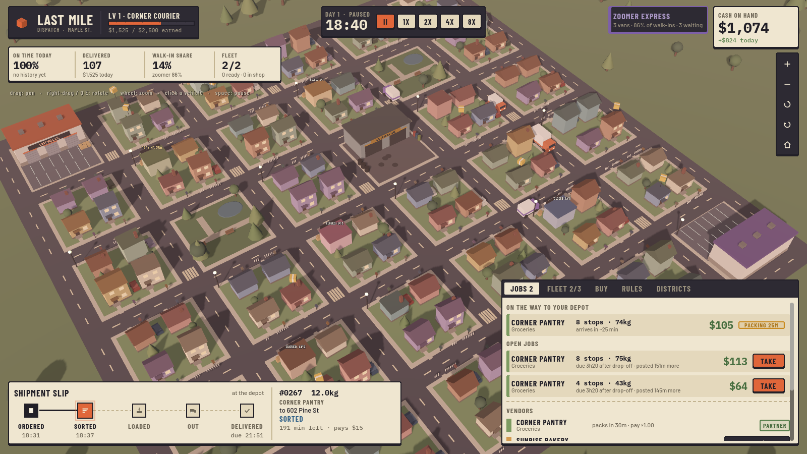
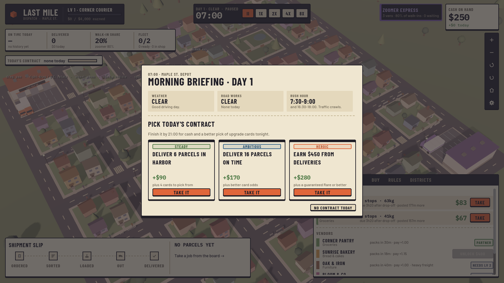
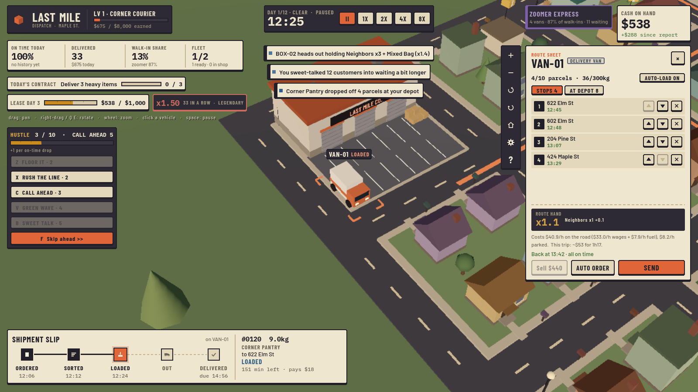
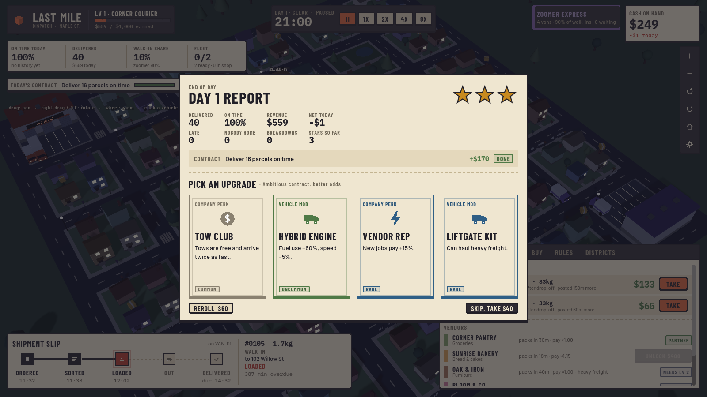
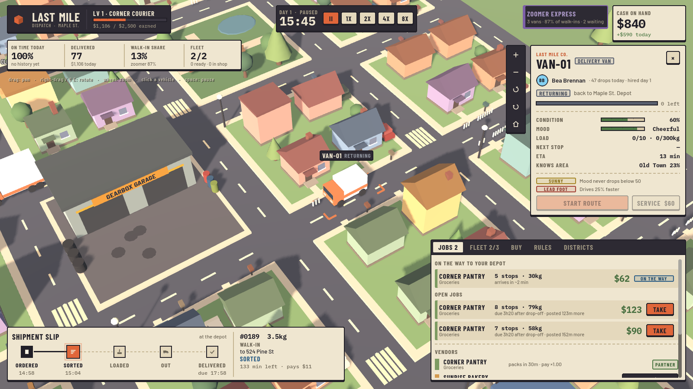

# Last Mile — Prototype v0.5

A cozy-but-moody 3D logistics game about growing a tiny delivery outfit.
Open this folder in **Godot 4.7** and press **F5**.



Design notes and the long-term plan live in [docs/DESIGN.md](docs/DESIGN.md).

## The season (the roguelike run)

Every new game is a **12-day season** on a fresh, randomly seeded town.

- **Rent is due every third evening** (days 3, 6, 9, 12) and climbs each week:
  $350, $800, $1,500, $2,400. It's billed at 21:00 from the cash in your till, so every
  van you buy is a bet against making rent.
- **Miss a payment** and you get a **final notice**: what you have is taken, the rest plus
  a 20% late fee rolls into next week's rent. Miss again and you're **evicted**: run over.
- **Twists.** Each week rolls a twist that hits on its due day, and the briefing warns you
  two days ahead: Gridlock, Heatwave, Inspector Visit (late parcels are fined), Zoomer
  Blitz, Viral Unboxing, Tight Promises.
- **Day 12 is Holiday Peak**: double demand on top of the week's twist, with the
  biggest rent of the season due that night. Pay it and you've won.
- **Delivery streak.** Every on-time drop in a row adds +4% to the pay of every drop
  (x2.0 at 25). A late parcel or "nobody home" breaks it. Streak tiers pop on screen and
  the floating pay numbers grow hotter as it climbs.
- **Savings interest.** Each evening you earn $5 per $100 in the till (up to $25), so
  hoarding for rent pays a little, and spending has a cost.

### Charters and heat

Pick a **charter** (starting company) and a **heat** level before each season.

| Charter | Start | Twist |
|---|---|---|
| Corner Courier | pick 2 vehicles, $250 | the classic |
| Green Courier | Eco Tune on every vehicle, +5% walk-in share | only $150 |
| Budget Freight | $700 | rent +25%, grumpy drivers |
| Premium Express | Sprinter + Van, walk-ins pay +35% | promises 20% tighter |
| Heavy Haulers | Box truck + liftgate Van, Oak & Iron unlocked | -5% walk-in share |

**Heat 1–8** stacks extra pressure (pricier rent, a bigger rival, smaller drafts, no final
notice, twists twice a week, tighter promises, more breakdowns). Winning at a heat
unlocks the next one, and higher heat scores and earns more reputation.

### Head office (between runs)

Runs end, but your **reputation** stays. You earn it from stars, rent paid, your best
streak, winning, and one-off **goals** ("Deliver 80 parcels in one day", "Win at heat 3",
"Win with 3 different charters", …). Spend it at **Head office** on permanent upgrades
(Bigger Till, Friendly Landlord, Lucky Dice, Talent Scout, Hype Crew, Second Chances,
Card Shark) or to unlock charters. The title screen always tells you what the next
unlock costs.

### Daily run

One seeded season per day: same town, same charter, heat 2, no HQ upgrades, so scores
compare fairly. Your best score per day and your **days-in-a-row streak** are kept.

## How a day goes

1. **Morning briefing (07:00).** See the weather (clear, rain, fog), road works and rush
   hours, then **pick one of three contracts** (Steady, Ambitious, Heroic). Finishing one
   by 21:00 pays cash and improves tonight's card draft.
2. **Take jobs** from the JOBS board. Pay depends on stops, weight and distance. Heavy
   freight needs a box truck (or a Liftgate Kit). **RUSH orders** pop up during the day:
   big pay, 20 minutes to accept, one-hour promise.
3. **Plan and load.** Click a vehicle at the depot to open its **route sheet**: reorder
   stops with the arrows and watch predicted arrival times. Red = late, yellow = nobody
   home yet (some customers are only in after 17:00, some only before noon, some need a
   signature). Load or unload parcels from the AT DEPOT tab. Then **SEND IT**.
4. **React.** Rush hour and rain slow everyone down. Road works close streets for the day.
   If a vehicle **breaks down**, send a **rescue** from the depot to grab its parcels
   before the tow truck hauls them back. Failed "nobody home" drops ride back and need
   another attempt.
5. **Evening (21:00).** Report card with up to 3 stars, then **draft one upgrade card**
   (reroll for cash, or skip for $40). The night shift runs on its own until morning.

## Upgrade cards

Four rarities: Common, Uncommon, Rare, **Ultra rare**.

- **Vehicle mods** go on one vehicle. Vans and sprinters have 2 slots, box trucks 3, so
  you build specialists. Examples: Eco Tune, Roof Rack, Reinforced Drivetrain,
  Hybrid Engine, Route GPS, Cargo Tetris, Liftgate Kit, Hypermiler, Comfy Cab, and the
  ultra rares **Turbo** (+45% speed) and **Golden Wrench** (never breaks down).
- **Company perks** apply to everything: Bulk Fuel Deal, Tow Club, Night Sort Crew,
  Friendly Mechanic, Loyalty Cards, Vendor Rep, Mechanic's Friend, and the ultra rare
  **Express Lane** (+30 min on every promise).
- **Streak and rent perks**: Tip Jar, Piggy Bank, Doorbell Cam (nobody-home won't break
  your streak), Second Wind, Lease Haggler, Hype Train (streak cap 40), and the ultra rare
  **Golden Hour** (streak never drops below 10).

Lifetime earnings still raise your **business level** (bigger fleet cap, more vendors).
Auto-dispatch is in RULES for when you'd rather not plan every trip.

## Vehicles

| | Cost | Speed | Parcels | Max load | Notes |
|---|---|---|---|---|---|
| Delivery Van | $550 | 1.0 | 10 | 300 kg | all-rounder |
| Box Truck | $950 | 0.78 | 16 | 900 kg | liftgate (heavy freight), thirstier, wears faster |
| Sprinter Van | $700 | 1.2 | 8 | 180 kg | unlocks at Lv 2 |

## Vendors

Corner Pantry (start) · Sunrise Bakery · Oak & Iron (furniture, needs a box truck)
· Bloom & Co. · Byte Electronics · Pharma Plus. Better vendors pack faster and pay more.

## Title screen and saves

The game opens on a title screen: **Continue** (most recent save), **New season**,
**Daily run**, **Head office**, **Load game**, **Settings**, **Quit**. There are
**3 save slots**; a slot is freed when its season ends. Reputation, upgrades, goals and
records live in `user://profile.dat`, separate from the slots. The game autosaves
at the start of every in-game day, when you leave to the menu, and when you quit.
**Esc** in game opens the pause menu (resume, save, settings, main menu, quit).

Saves store the full game state (fleet, drivers, parcels in flight, jobs, garage
queue, RNG state), so loading is instant and continues exactly where you left off.
Files live in Godot's `user://` folder (`save_1.sav` … `save_3.sav`).

## Settings (pause menu, title screen, or the gear button)

Window mode, resolution, UI scale, VSync and FPS limit, plus a **Low / Medium / High**
graphics preset (3D render scale, anti-aliasing, shadows, fog, scenery detail).
On first launch the game reads the graphics card and picks a preset: integrated or
software GPUs start on Low. The game uses Godot's Compatibility renderer (OpenGL 3.3,
with an ANGLE/DirectX fallback on Windows), so it runs on older and low-end PCs too.
Settings are saved to `user://settings.cfg`.

## Controls

| Action | Input |
|---|---|
| Pan | Left-drag, or WASD / arrows |
| Rotate | Right-drag, or Q / E |
| Zoom | Mouse wheel, or + / − buttons |
| Reset view | H |
| Select a vehicle | Click it, or click its row in FLEET |
| Pause / resume | Space |
| Pause menu | Esc (when nothing is selected) |
| Speed 1x / 2x / 4x / 8x | 1 / 2 / 3 / 4 |

## Code layout

```
scripts/
  main.gd               Clock, start screen, tutorial, wiring
  sim/                  Pure, deterministic simulation (no nodes)
    sim.gd              Step loop, commands, jobs, wear/breakdowns, garage, reputation
    city.gd             Road graph, houses, vendor lots, garage block
    mover.gd            Shared path-following for vehicles and couriers
    van.gd              Vehicle state machine
    vehicle_types.gd    Van / Box Truck / Sprinter stats
    vendors.gd          Vendor list + business levels
    job.gd              A vendor delivery order
    save_game.gd        3-slot save/load of the full game state
    cards.gd            Upgrade cards, rarities and the draft roll
    contracts.gd        Daily contracts
    season.gd           The run: rent schedule, twists, charters, heat, streak tuning, score
    profile.gd          Persistent meta-progression: reputation, HQ upgrades, goals, daily streak
    parcel.gd, driver.gd, traits.gd, company.gd, rival_ai.gd
  view/                 3D town built from primitives (world_view.gd), camera, palette
  ui/                   Dispatcher's-desk UI: hud, title, run setup, head office, run summary,
                        pause, settings, start screen, tutorial, widgets
  settings/             Display + graphics settings and GPU-based preset detection
fonts/                  Barlow, Barlow Condensed, IBM Plex Mono (SIL Open Font License)
tools/
  autoplayer.gd         Scripted player used by the tests
  sim_test.gd           Headless 4-day run with a scripted player + determinism check
  save_test.gd          Save mid-game, load, run both forward and check they match
  season_test.gd        Plays whole seasons at several heats, prints every rent bill, checks determinism
  screenshot.gd         Renders a PNG (modes: title, picker, settings, briefing, play, route, report, rain)
```

### Multiplayer-ready rules (keep these)

1. The sim only advances with `sim.step()`; it never reads frame time or physics.
2. All randomness comes from `sim.rng` (seeded).
3. Every player or AI action is a command sent with `sim.submit({...})`.

Run the sim test: `godot --headless --path . -s tools/sim_test.gd`
Run a full season: `godot --headless --path . -s tools/season_test.gd`

## Screenshots

| Morning briefing | Route sheet |
|---|---|
|  |  |
| **Evening report and card draft** | **A van on its route** |
|  |  |
