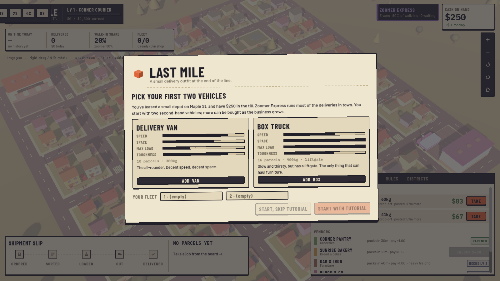

# Last Mile — Prototype v0.3

A cozy-but-moody 3D logistics game about growing a tiny delivery outfit.
Open this folder in **Godot 4.7** and press **F5**.


Design notes and the long-term plan live in [docs/DESIGN.md](docs/DESIGN.md).

## How a game goes

1. **Pick your first two vehicles**: delivery vans, box trucks, or one of each.
2. **Take jobs** from the JOBS board. Vendors post orders; pay depends on the
   number of stops, total weight, and how far they are from your depot.
   Heavy freight (furniture) needs a box truck.
3. The vendor **packs** the order, then their courier drives it to your depot.
4. Parcels are sorted and **loaded**. A vehicle stamped **READY** waits for you:
   press **GO** (or **Start route**). Turn on **Auto-dispatch** under RULES later.
5. Get paid on delivery. Late drops pay 30% and hurt your reputation.
6. Lifetime earnings raise your **business level** → bigger fleet cap, more vendors.
7. Vehicles **wear out**. Worn ones can **break down**: tow ($45), then they queue
   at **Gearbox Garage** (2 bays, shared with Zoomer Express) for a repair ($160, ~2h).
   A service at the garage is $60 and ~35 min. RULES has an auto-service setting.

The tutorial (offered on the start screen) walks through steps 2–4.

## Vehicles

| | Cost | Speed | Parcels | Max load | Notes |
|---|---|---|---|---|---|
| Delivery Van | $550 | 1.0 | 10 | 300 kg | all-rounder |
| Box Truck | $950 | 0.78 | 16 | 900 kg | liftgate (heavy freight), thirstier, wears faster |
| Sprinter Van | $700 | 1.2 | 8 | 180 kg | unlocks at Lv 2 |

## Vendors

Corner Pantry (start) · Sunrise Bakery · Oak & Iron (furniture, needs a box truck)
· Bloom & Co. · Byte Electronics · Pharma Plus. Better vendors pack faster and pay more.

## Title screen and saves

The game opens on a title screen: **Continue** (most recent save), **New game**,
**Load game**, **Settings**, **Quit**. There are **3 save slots**. The game autosaves
at the start of every in-game day, when you leave to the menu, and when you quit.
**Esc** in game opens the pause menu (resume, save, settings, main menu, quit).

Saves store the full game state (fleet, drivers, parcels in flight, jobs, garage
queue, RNG state), so loading is instant and continues exactly where you left off.
Files live in Godot's `user://` folder (`save_1.sav` … `save_3.sav`).

## Settings (pause menu, title screen, or the gear button)

Window mode, resolution, UI scale, VSync and FPS limit, plus a **Low / Medium / High**
graphics preset (3D render scale, anti-aliasing, shadows, fog, scenery detail).
On first launch the game reads the graphics card and picks a preset: integrated or
software GPUs start on Low. The game uses Godot's Compatibility renderer (OpenGL 3.3,
with an ANGLE/DirectX fallback on Windows), so it runs on older and low-end PCs too.
Settings are saved to `user://settings.cfg`.

## Controls

| Action | Input |
|---|---|
| Pan | Left-drag, or WASD / arrows |
| Rotate | Right-drag, or Q / E |
| Zoom | Mouse wheel, or + / − buttons |
| Reset view | H |
| Select a vehicle | Click it, or click its row in FLEET |
| Pause / resume | Space |
| Pause menu | Esc (when nothing is selected) |
| Speed 1x / 2x / 4x / 8x | 1 / 2 / 3 / 4 |

## Code layout

```
scripts/
  main.gd               Clock, start screen, tutorial, wiring
  sim/                  Pure, deterministic simulation (no nodes)
    sim.gd              Step loop, commands, jobs, wear/breakdowns, garage, reputation
    city.gd             Road graph, houses, vendor lots, garage block
    mover.gd            Shared path-following for vehicles and couriers
    van.gd              Vehicle state machine
    vehicle_types.gd    Van / Box Truck / Sprinter stats
    vendors.gd          Vendor list + business levels
    job.gd              A vendor delivery order
    save_game.gd        3-slot save/load of the full game state
    parcel.gd, driver.gd, traits.gd, company.gd, rival_ai.gd
  view/                 3D town built from primitives (world_view.gd), camera, palette
  ui/                   Dispatcher's-desk UI: hud, title, pause, settings, start screen, tutorial, widgets
  settings/             Display + graphics settings and GPU-based preset detection
fonts/                  Barlow, Barlow Condensed, IBM Plex Mono (SIL Open Font License)
tools/
  sim_test.gd           Headless 3-day run with a scripted player + determinism check
  save_test.gd          Save mid-game, load, run both forward and check they match
  screenshot.gd         Renders a PNG (modes: title, picker, tutorial, play, wide, low, settings)
```

### Multiplayer-ready rules (keep these)

1. The sim only advances with `sim.step()`; it never reads frame time or physics.
2. All randomness comes from `sim.rng` (seeded).
3. Every player or AI action is a command sent with `sim.submit({...})`.

Run the sim test: `godot --headless --path . -s tools/sim_test.gd`

## Screenshots

| Start screen | A van on its route |
|---|---|
|  |  |
